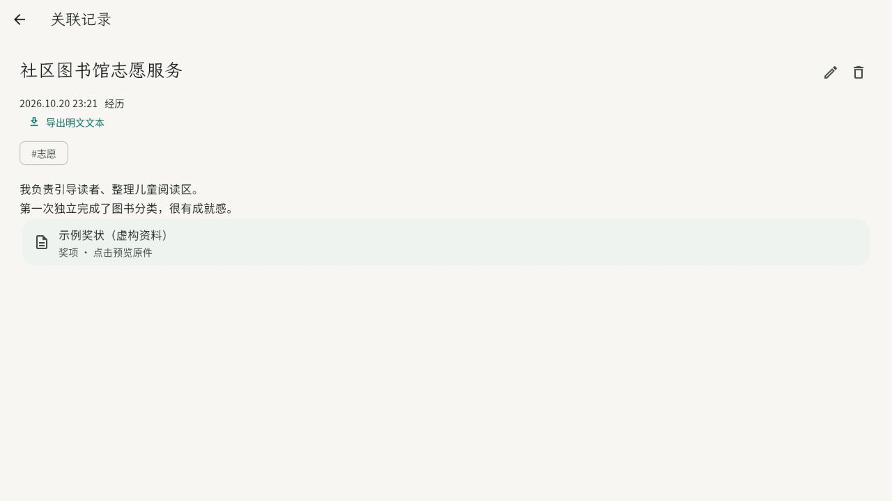
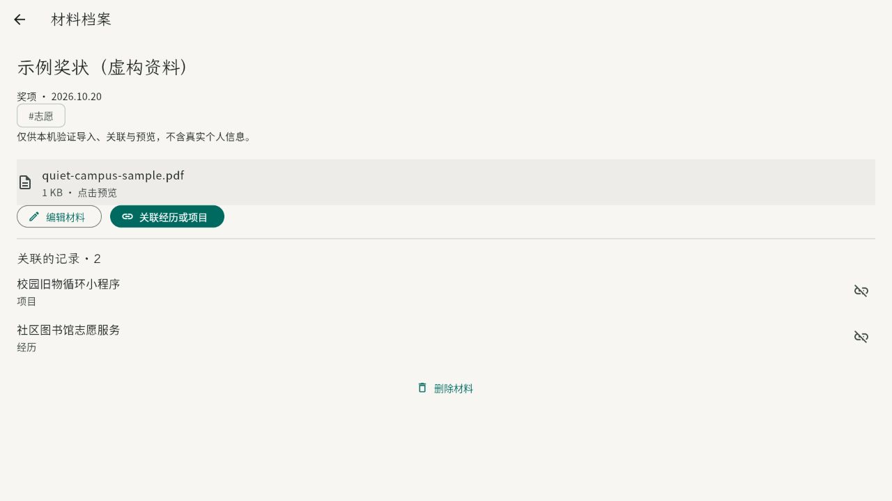
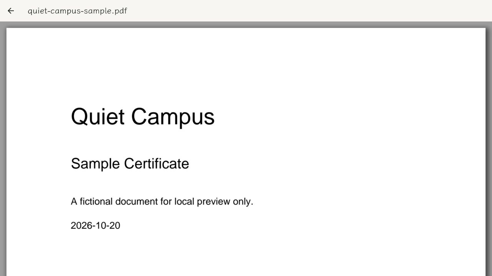

# 材料库接入记录 · 0.2.0

原 Flutter 项目内新增材料库，没有替换 Quill、SQLite、密码算法或 Supabase 接口；没有应用数据库迁移。

## 使用流程

档案 → 材料库 → 导入材料 → 选择图片/PDF → 填写名称、分类、说明、标签与本地日期 → 保存。材料详情可关联已有经历/项目；任意日记、经历、项目的原编辑器也可“插入材料引用”。点击正文卡片可打开内存预览。

支持 PNG/JPEG/WebP/GIF/PDF，每份最多 20 MiB。按系统文件选择器导入，不读取整个文件库。PDF 使用 pdfrx 2.9.0；没有 OCR、AI、在线转换、语音、视频或 Office 编辑。

演示入口：http://127.0.0.1:7357/ 。档案 → 材料库有“加入虚构的示例 PDF”按钮。演示仅当前页面内存保存，刷新重置；原生客户端仍使用原有本机密文缓存和账号同步。请勿在演示导入真实证件。

## 数据与隐私

- 材料是独立 `Entry(kind: material)`，名称、说明 Delta、分类、日期、标签、原文件名均在原有 `sealJson` 内。原件沿用认证二进制附件帧与随机 ID，不新增明文数据库列或对象名。
- 记录中保存 Quill 自定义嵌入块 `custom: {"quiet-material-v1": "材料 UUID"}` 的 JSON 字符串。只引用 ID，不写原件字节、公开链接或重复附件。材料详情反向扫描同账号本地记录生成关联列表。
- 引用沿用记录自身的版本、待同步队列和冲突机制。解除关联只移除引用；删除记录不删除材料；删除材料生成墓碑，引用保留并提示已删除。未到达本机的材料显示暂不可用；原件下载失败显示重试。
- 原件下载完成前检查账号/存储是否切换，解密前检查仍持有同一已解锁 vault，防止异步下载回到已锁定会话。
- 图片与 PDF 只从 `readAttachment` 返回的解密内存字节显示。PDF 不接 URI、外链跳转或在线字体管理器；WASM 从本地应用 assets 加载。没有持久化明文缩略图。PDF 预览内存阈值覆盖 20 MiB 文件上限。
- 预览关闭/锁定会清零应用持有的解密字节、驱逐图片缓存；原生根导航在锁定时关闭叠加页面。pdfrx 负责释放渲染器内存与 PDF 文档。Dart/系统渲染器内存不是可逐字节证明清零的安全内存；本功能不声称抵御受控终端。
- 不进行附件物理回收，保留原来“直到删除账号才清理无引用密文”的策略。

## 兼容、搜索和备份

新客户端读取 v1 和 v2。材料及含嵌入块的记录写 v2；其余原记录继续 v1。旧客户端 0.1 不理解 v2，会拒绝解析/无法显示相关档案，原始密文不被转换或抹去；**开始使用材料前，应升级同账号的所有设备至 0.2。** 旧设备仍在编辑的版本由原 CAS/冲突机制保留，需本人选择；没有把旧二进制远程改造成兼容客户端。

未知版本/类型明确报需要升级；本版无法识别的嵌入块用占位提示显示，Quill Delta 原值仍保留。未来新增字段仍需相应版本门槛，不能宣称任意未来格式都兼容。

材料不计入随笔次数、项目数、字数或日期统计。随笔搜索可同时命中材料名称、说明、标签、分类和材料类型，点击材料打开其档案；材料库复用同一规范化顺序字符搜索。标签使用原加密历史目录与关联管理，不建立隔离标签系统。没有 PDF 内文/OCR 索引，没有上传搜索词。

明文文本导出把嵌入块转换为材料 ID 提示，明确原件不随文本导出；随笔 JSON 保留完整 Delta 引用，但排除材料库元数据和原件。完整加密备份仍遍历所有有效记录与冲突中的附件 ID，包含独立材料和单份原件；缺少原件则导出失败。独立解密工具保留材料元数据、Delta 引用和附件。

## 依赖核对

pdfrx 2.9.0 要求 Dart 3.13 / Flutter 3.47，与现有 3.13.5 / 3.47.7 匹配；pubspec.yaml 与 lock 锁定解析版本。MIT 包许可及 PDFium 的 BSD/第三方许可已保留，详见 THIRD_PARTY_NOTICES.md 与 assets/licenses/pdfium/。iOS 工程既有最低版本 15.0 满足其 Darwin 插件要求。正式发布仍应按各平台最终二进制复核附带声明。

## 验证记录

2026-10-20 至 2026-10-21 的实际证据：

| 验证 | 结果与范围 |
| --- | --- |
| Flutter 测试 | 38 项通过，包括原有 32 项及新增 6 项；实际 Flutter Widget 引擎验证图片导入、保存、材料排除统计、原编辑器插入引用、关联/解除/删除、窄屏、图片预览重试、锁定时清零应用字节；高亮与导出不写回 Delta。 |
| SQLite 与同步 | 使用真正由 Dart VaultCrypto 产生的合成密文夹具，写入实际 SQLite 后关闭/重新打开；单份原件与引用保持，离线队列重试先上传原件，模拟第二设备的删除/编辑冲突保留直到本人选择。网络对端是内存测试服务，不是 Supabase。 |
| 密码与备份 | Dart 编译为 JS，在 Node + libsodium WASM 执行原密码实现，验证材料名称、说明、分类、文件名均不出现在密文中，换设备/恢复密钥解密与引用保留。独立 Node 解密工具可读取 Dart 夹具。3 项 Node 顶层测试通过，覆盖备份缺原件拒绝及既有 PGlite 权限。 |
| 实际 Flutter 浏览器界面 | 已从档案进入材料库，经真实 FilePicker 文件选择器导入项目自带的虚构 PDF，填写名称/分类/说明/标签并保存；同一材料关联一段经历和一个项目后，点击正文卡片再次打开原件。也验证了“加入虚构的示例 PDF”入口。截图见下方。 |
| 原生构建/云端 | 未完成 Windows/iOS/Android 安装构建与真实 Supabase 联调。Windows 缺 Visual Studio C++，Android SDK、macOS/Xcode、配置好的同步服务均未提供。 |

测试环境跳过 `crypto_test.dart` 的原生 libsodium 测试。为运行本机 Widget/SQLite 测试，暂时跳过本地缓存的 pdfium_dart 原生构建钩子并在 finally 恢复，另设置 `NIX_SKIP_SODIUM_BUILD_HOOKS=1`；使用 `--no-test-assets`，测试主题禁用 InkSparkle。**这些测试没有证明原生 PDFium 或原生 libsodium 构建通过。** PDF 实际显示另由随包 WASM 在 Flutter Web 验证。标准构建/测试应在具备原生工具链的环境运行，不应永久改动依赖构建钩子。

`test/fixtures/material-vault.json` 只含合成资料、公开测试口令和随机测试密文，来自本项目 Dart 密码自检，不能用于真实档案。

本地 Web 构建使用既有中文路径 shader 临时修复，并扩展至 pdfrx 引入的 material_ui shader；结束时恢复源文件。浏览器演示始终没有账号/本机加密缓存，不能替代加密云端客户端验收。系统文件选择器、原生渲染释放、三端长时间运行、复杂/加密/未嵌字体的 PDF 与真实设备锁定仍需真机检查。

