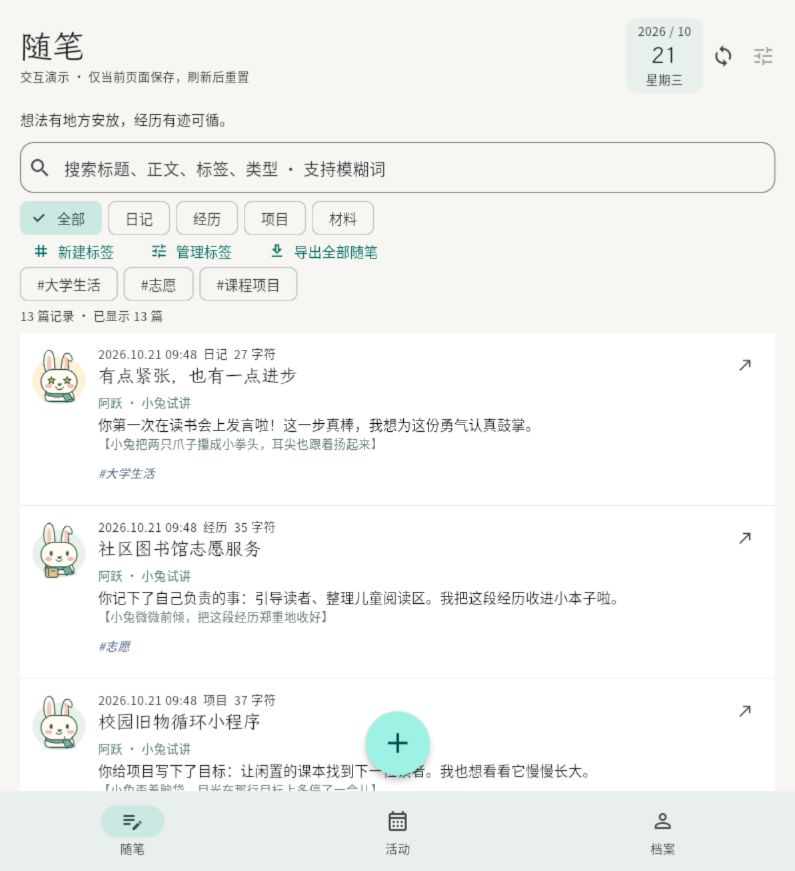
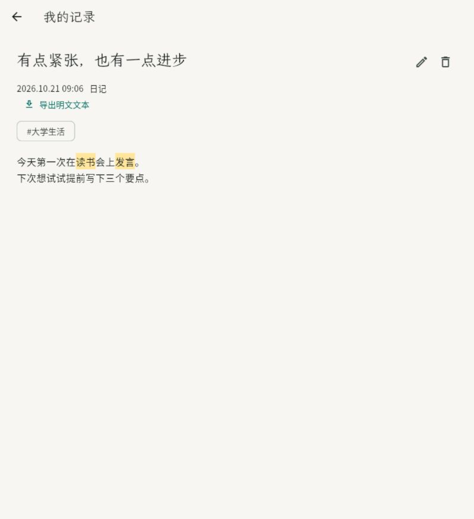

# 小兔讲述试作

2026-10-21，在原 Flutter 随笔列表接入原创小兔阿跃（暂名，取“动若脱兔”）。暖白身体、折起的一只耳朵、青绿围巾，提供星星眼、抱本子、托腮、安静陪伴四种表情。形象由本项目 Flutter CustomPainter 绘制，没有复制多邻国形象、源码或素材，也未添加新依赖。鼠标进入时小幅倾斜，尊重系统减少动态效果设置；没有催更、打卡、惩罚或连续播放动画。

默认“小兔讲述”用一句回应加【小兔神态动作】替代随笔原始正文摘要；原始标题、日期和标签保留。卡片或右侧箭头打开原始富文本；右侧箭头不再直接打开编辑器，编辑仍在详情中。材料库记录与活动仍使用其原有摘要，不分析附件内容。

列表不再提供“小兔讲述 / 原文摘要”切换或重复的“原文有匹配 · 点开查看”提示，点击记录块即可查看原文。规则能力说明保留在已有“阿跃 · 小兔试讲”文字的悬停/长按提示中，没有新增图标。搜索始终查询原始标题、正文、标签、类型等，点击后全文高亮；小兔文本若恰好包含搜索词，可在显示层高亮，但不能因为只匹配小兔的话而返回该记录。块内标签改为 12 号深蓝斜体，无边框、无底色，保留点击筛选和足够的触摸区域；上方历史标签筛选栏保持原有样式。

## 当前能力边界

### 图片与文字分开（2026-10-21 调整）

图片仍只有欣喜、倾听、思考、陪伴四类倾向；【】中的舞台描写是独立字段，不再由图片表情直接生成。五种已有情境各配四条原创描写，共 20 条，包括动作、神态、语气及少量本子/书签等场景细节；承担工作和日常记录共用“倾听”图片，但使用不同描写。按记录 ID 在相应情境内稳定选取，滚动、搜索、重开或更改昵称不会随机换词；内容修改导致规则情境变化时可改变描写。

这些描写只刻画虚构小兔，不补写用户的行为、经历或心理；没有从小说、剧本或第三方语料复制句子。讲述仍使用原有有限规则，并未因增加描写而获得新的事件理解能力。图片的无障碍说明仅表达大类倾向，不再复用文字动作。20 条是首批人工编写素材，不是开放式生成；相近记录仍可能重复。

### 语料资源筛查

本轮核对原始来源，区分“词义/情感词典”和“可直接用于产品的叙述句”：

| 资源 | 用途与许可核对 | 本轮处理 |
| --- | --- | --- |
| [Chinese Open Wordnet / COW](https://github.com/omwn/omw-data/tree/main/wns/cow) | 中文词义及词汇关系资源；其[软件与数据库许可证](https://github.com/omwn/omw-data/blob/main/wns/cow/LICENSE)允许为任何目的使用、修改、分发，须保留版权、条款及免责声明；并非现成舞台描写句库。 | 可作为后续词汇辅助候选，未导入数据或添加依赖。 |
| [大连理工情感词汇本体](https://ir.dlut.edu.cn/info/1013/1142.htm) | 原始下载页明确“仅供科研及教学使用”；不能凭某个转存仓库的代码 MIT 许可推断原始词典可商用。 | 排除本轮商业集成。 |

当前选择原创本地描写库即可完成体验，不引入完整 NLP 工具链、在线语料服务或新模型。若后续采用 COW，应锁定具体数据版本并随分发保留完整许可；本次未使用其词条。

这是明确标示的本机规则试讲，并非 AI 或通用语义概括：

- 对明确的“第一次在读书会上发言”给出鼓励；对“我负责…”截取承担事项；对项目“目标：…”复述目标；对少数第一人称感受给予安静陪伴。
- 未识别到规则时用中性书签回应，不补写事件、人物、地点或心理状态。
- 排除部分未来、否定、引用、他人主语和疑问句。规则不能可靠理解所有中文表达、反讽或复杂情绪；说明图标明确展示此限制。
- 有个人资料昵称时用于称呼，留空时称“你”。回应中小兔的态度属于产品表达，不能当作用户原话。

讲述只对已在内存中的记录临时计算，不写回 Entry/Delta、标签、数据库、同步或导出；锁定和清理沿用原项目。没有接入第三方模型、上传原文、读取证件原件或新增 AI 服务。真正的通用概括仍需单独评估端侧模型、三端运行成本与用户控制。

## 验证

当前小兔相关 5 项测试：昵称与原始富文本/导出不变；20 条描写在五类情境中的多样性、同条记录稳定性和不写回数据；未来、否定、引用、他人、疑问的回退；390/320 窄屏下小兔预览、移除切换栏、块内标签样式与筛选、原文搜索及箭头打开全文；全部原创表情、独立无障碍标签及减少动态设置。

本次移除切换栏并调整标签后，小兔、完整随笔流程及标签关联共 13 项 Flutter 测试以 concurrency=1 通过，包含编辑、全文高亮和导出仍使用原文的检查。测试沿用本机临时跳过 sodium/pdfium 原生构建钩子的方式，结束时核对依赖源文件已恢复；未验证原生三端安装包与真实 Supabase。

最新本地预览：http://127.0.0.1:7357/ 。演示仍只在页面内存保存，刷新重置。正式加密客户端继续使用原来的数据层。

实际 Flutter Web 已在 795×871 窗口验证“读书发言”模糊检索、小兔讲述及【神态动作】显示，并点击箭头进入保留搜索高亮的原始富文本详情；临时窗口尺寸已恢复。Web 构建及静态分析通过。

